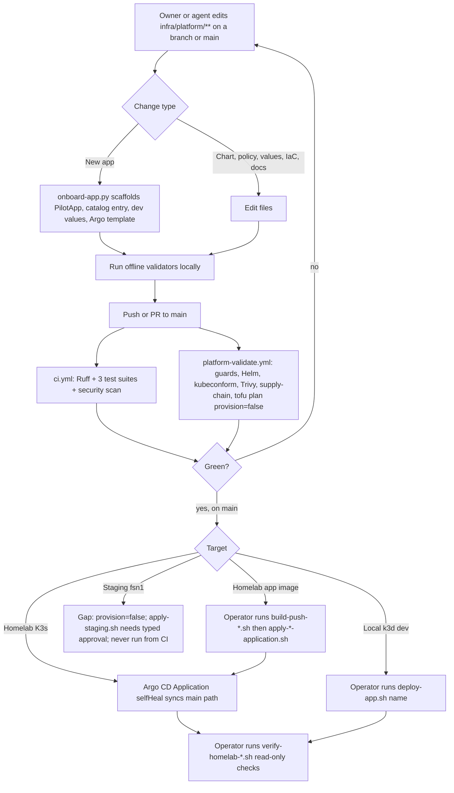
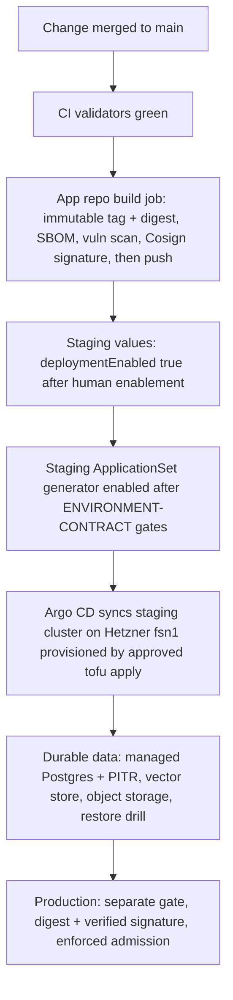

# 01 — Business process (As-Is / To-Be)

repo นี้ไม่มีธุรกิจหรือลูกค้าภายนอก ([PRODUCT.md](../../PRODUCT.md): "No external users") กระบวนการที่มีคือ **กระบวนการ platform ของ owner**: เปลี่ยน desired state ใน Git → ตรวจ offline ใน CI → (สำหรับ Homelab) Argo CD sync เข้า cluster; การขึ้น cluster/โครงสร้างใหม่ทำมือโดย operator

## As-Is (จากไฟล์วันนี้)

Sources: `PRODUCT.md`, `README.md`, `.github/workflows/ci.yml`, `.github/workflows/platform-validate.yml`, `infra/platform/onboarding/README.md`, `infra/platform/onboarding/scripts/onboard-app.py`, `infra/platform/bootstrap/local/deploy-app.sh`, `infra/platform/bootstrap/homelab/README.md`, `infra/platform/gitops/homelab/applications/*.yaml`, `infra/platform/iac/scripts/apply-staging.sh`, `infra/platform/iac/envs/staging/fsn1/variables.tf`

ข้อเท็จจริงสำคัญ
- CI ไม่ apply อะไรเข้า cluster เลย (PRODUCT.md "Nothing here has been applied to a cluster from CI")
- Homelab Applications ใช้ `selfHeal: true`, `prune: false`; การ apply Application ครั้งแรกทำมือด้วย `kubectl apply` ผ่าน SSH (`apply-*-application.sh`)
- Image tag ของแอป Homelab เป็นค่า `git-<sha>` ที่เขียนตรงใน Application (`image.tag` parameter) จึงต้อง commit ค่าใหม่เมื่อเปลี่ยน image

## To-Be (จากเอกสารใน repo เท่านั้น)

แหล่ง To-Be ที่มีใน repo: `PRODUCT.md` (Limits), `operations/platform/PRODUCTION-GAPS.md`, `infra/platform/supply-chain/README.md` ไม่มี `specs/` หรือ `docs/UPGRADE-PLAN.md`

Sources: `operations/platform/PRODUCTION-GAPS.md` (Summary table), `infra/platform/supply-chain/README.md` ("CI contract", "Promotion levels"), `infra/platform/DATA-CONTRACT.md` ("Named data contracts"), `infra/platform/gitops/applications/applicationset.yaml` (disabled staging/production elements), `infra/platform/iac/envs/production/README.md`

ทุกขั้นใน To-Be เป็น **gap** ณ วันนี้ (PRODUCTION-GAPS: Cosign "enforcement not active", SBOM "Not published in CI", Staging app deployment `deploymentEnabled: false`)

## Open questions

- ไม่มีวันที่หรือ owner decision ว่าจะเริ่ม staging เมื่อไร (PRODUCTION-GAPS ไม่ระบุ timeline)
- PR #1 "Add reproducible shared-service delivery and bounded staging validation" ยังเปิดอยู่และไม่อยู่ใน `main` (PRODUCT.md Limits) — เป็นส่วนหนึ่งของ To-Be หรือไม่
