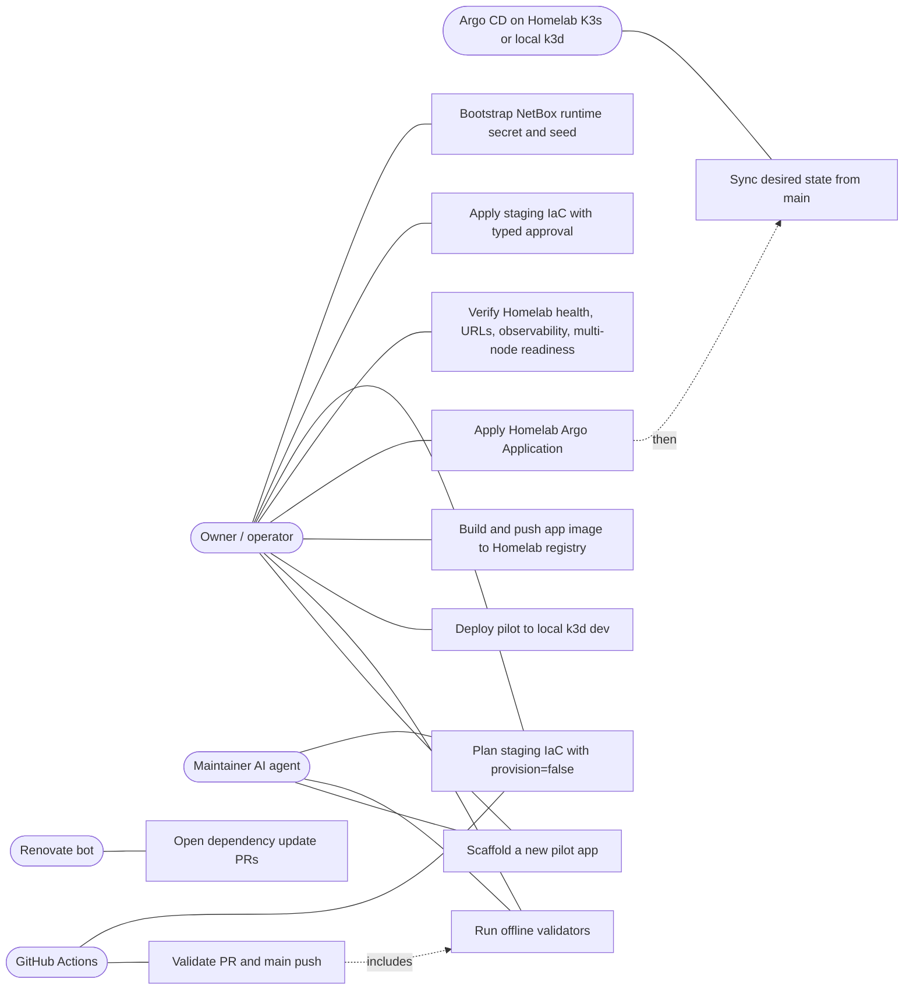

# 02 — Use cases

ไม่มี auth level ในโค้ด (repo ไม่มี runtime) actor จึงเป็นบทบาทที่ไฟล์อ้างถึงจริง: owner/operator (รัน scripts จาก "Operator workstation"), AI agents (PRODUCT.md "the agents that maintain the owner's infrastructure"), GitHub Actions, Argo CD, Renovate

Sources: `PRODUCT.md`, `infra/platform/onboarding/scripts/onboard-app.py`, `infra/platform/bootstrap/local/deploy-app.sh`, `infra/platform/bootstrap/homelab/README.md` (Scripts table, column "Where"), `infra/platform/bootstrap/homelab/bootstrap-netbox.sh`, `infra/platform/gitops/homelab/applications/*.yaml`, `infra/platform/iac/scripts/plan-staging.sh`, `infra/platform/iac/scripts/apply-staging.sh`, `.github/workflows/ci.yml`, `.github/workflows/platform-validate.yml`, `renovate.json`

| Use case | Actor | Entry point | Writes to cluster/cloud? |
|---|---|---|---|
| Scaffold app | owner, agent | `onboard-app.py --name … [--dry-run]` | no (files only; "never deploys") |
| Offline validators | owner, agent, CI | 3 test suites + 6 validators (README "ตรวจสอบ") | no |
| Local deploy | owner | `deploy-app.sh <name>` | yes, local k3d only |
| Homelab image | owner | `build-push-{ai-doc-assistant,booknbook}.sh` | pushes to `registry.homelab.local:5000` |
| Homelab Application | owner | `apply-*-application.sh` (SSH + `kubectl apply`) | yes, Homelab K3s |
| Sync | Argo CD | Applications `selfHeal: true` | yes |
| Verify | owner | `verify-homelab-*.sh`, `audit-multinode-readiness.sh` | no (scripts say read-only) |
| Staging plan | CI, owner | `plan-staging.sh` | no (`provision=false`, dummy token) |
| Staging apply | owner | `apply-staging.sh apply` + type `APPLY-STAGING-FSN1` | yes (Hetzner) — never run per PRODUCT.md |
| Dependency PRs | Renovate | `renovate.json` (Mon before 9am BKK) | no |

## Open questions

- ไม่มีไฟล์ระบุสิทธิ์ของ agent (agent รัน `apply-*` / `deploy-app.sh` ได้หรือไม่) — ขึ้นกับ hook/permission นอก repo
