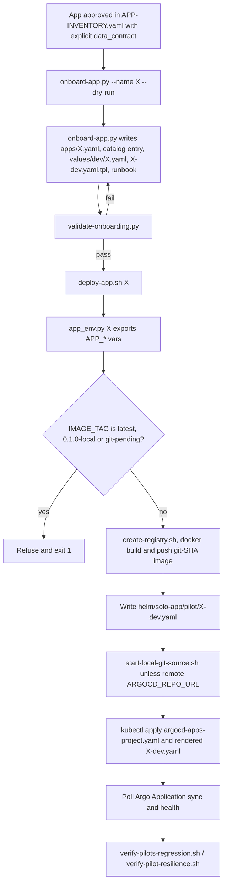
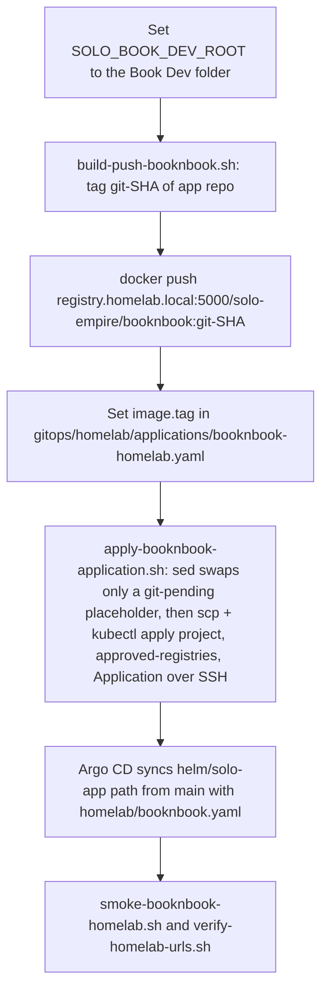
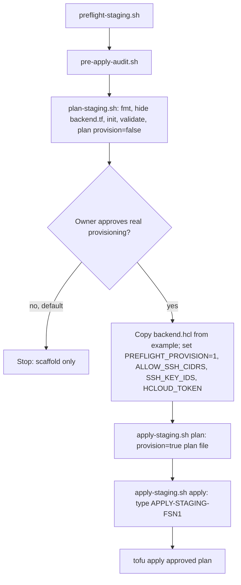

# 03 — User flows (operator journeys)

ไม่มี UI/route; "user" คือ operator ที่รัน scripts ตามลำดับที่ README/runbook กำหนด

## Flow A — onboard แอปใหม่จนถึง local k3d dev

Sources: `infra/platform/onboarding/README.md`, `infra/platform/onboarding/scripts/onboard-app.py`, `infra/platform/onboarding/scripts/app_env.py`, `infra/platform/bootstrap/local/deploy-app.sh`

Gap: `deploy-app.sh` ตั้ง `APP_DIR="$ROOT/${APP_SOURCE_PATH}"` โดย `ROOT` คือ root ของ repo นี้ แต่ `source_path` ใน `onboarding/apps/*.yaml` ยังเป็น path ของ solo-empire (`projects/product/engineering/...`) จึงจะหยุดที่ "app source not found" หากไม่ได้รันจาก checkout ที่มี path นั้น (ไม่ได้ทดสอบรันจริง)

## Flow B — ปล่อย image ใหม่ขึ้น Homelab

Sources: `infra/platform/bootstrap/homelab/build-push-booknbook.sh`, `infra/platform/bootstrap/homelab/apply-booknbook-application.sh`, `infra/platform/gitops/homelab/applications/booknbook-homelab.yaml`, `infra/platform/bootstrap/homelab/README.md`

หมายเหตุ: Application CR ถูก apply ด้วยมือ (ไม่มี app-of-apps ที่ให้ Argo ดูแล Application เอง) Argo จึง sync เฉพาะ `source.path`; การเปลี่ยน `image.tag` ต้อง apply Application ใหม่ ขั้น D ทำมือ เพราะ sed ใน script แทนเฉพาะค่า `git-pending` แต่ไฟล์ใน `main` เก็บ tag จริงไว้แล้ว (`git-7f3c6b8…`)

## Flow C — staging IaC (ยังไม่เคย apply)

Sources: `infra/platform/iac/README.md` (Commands), `infra/platform/iac/scripts/plan-staging.sh`, `infra/platform/iac/scripts/apply-staging.sh`, `.github/workflows/platform-validate.yml` (job `tofu-fmt`)

## Open questions

- ไม่มี flow สำหรับ rollback ของ Homelab app นอกจากแก้ tag กลับใน Git (ยังไม่มีเอกสาร) — ยืนยันว่าใช้วิธีนี้
