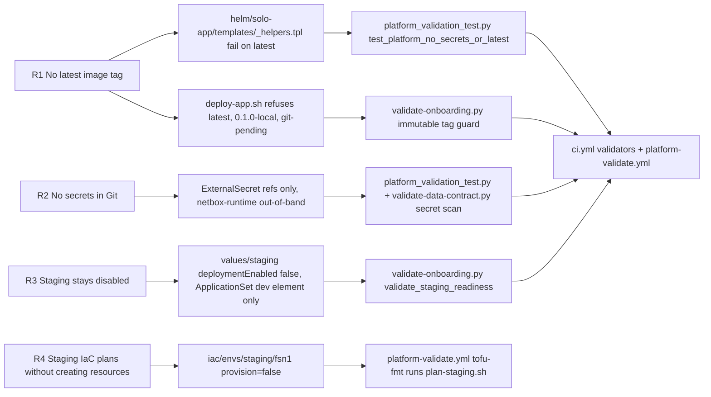

# 04 — Traceability (RTM)

ไม่มี `specs/` หรือ requirement ID ใน repo จึงใช้ข้อความใน `PRODUCT.md` และกฎใน contract docs เป็น requirement (ID ด้านล่างตั้งขึ้นในไฟล์นี้เพื่ออ้างอิงเท่านั้น)

Sources: `PRODUCT.md`, `infra/platform/ENVIRONMENT-CONTRACT.md`, `infra/platform/DATA-CONTRACT.md`, files named in the table

| ID | Requirement (source) | Code / config | Test or validator | Workflow |
|---|---|---|---|---|
| R1 | Never `:latest` (ENVIRONMENT-CONTRACT §2) | `helm/solo-app/templates/_helpers.tpl`; `bootstrap/local/deploy-app.sh`; Kyverno `disallow-latest-tag.yaml` (Audit) | `platform_validation_test.py` (`test_platform_no_secrets_or_latest`); `validate-onboarding.py`; `validate-image-policy.py` | `ci.yml`; `platform-validate.yml` jobs `helm-lint-and-template`, `secret-and-latest-scan`, `supply-chain-contract` |
| R2 | Secret values never in Git (DATA-CONTRACT "Isolation rules") | `templates/externalsecret.yaml`; `gitops/homelab/netbox/*.yaml` use `secretKeyRef` to `netbox-runtime` | `platform_validation_test.py`; `validate-data-contract.py` (`validate_platform_secret_scan`); `validate-onboarding.py` (`validate_no_secrets_in_onboarding`) | `ci.yml` (also gitleaks in `security.yml`); `platform-validate.yml` |
| R3 | Staging `deploymentEnabled: false`, no active staging generator (onboarding README "Guards") | `gitops/applications/values/staging/*.yaml`; `applicationset.yaml` | `validate-onboarding.py` (`validate_staging_readiness`) | both |
| R4 | `provision = false` default (iac README) | `iac/envs/staging/fsn1/variables.tf`, `main.tf` `check` blocks | `iac/scripts/plan-staging.sh` (no unit test) | `platform-validate.yml` job `tofu-fmt` |
| R5 | No DB subcharts in `solo-app` (DATA-CONTRACT "Separation") | `helm/solo-app/Chart.yaml` (no dependencies) | `validate-data-contract.py` (`validate_solo_app_chart_boundary`) | both |
| R6 | Homelab ai-doc-assistant is DEMO_ONLY (DATA-CONTRACT) | `helm/solo-app/homelab/ai-doc-assistant.yaml` (`SOLO_DATA_CONTRACT: demo-ephemeral`, chroma `emptyDir`) | `validate-data-contract.py` (`validate_homelab_demo_only`); runtime `verify-ai-doc-assistant-data-readiness.sh` (manual) | both (offline part) |
| R7 | Required probes, resources, labels (onboarding "Guards") | `templates/deployment.yaml`, values | `validate-onboarding.py` (`validate_values`); kubeconform | both |
| R8 | Staging renders include NetworkPolicy | `templates/networkpolicy.yaml` | inline shell in `platform-validate.yml` | `platform-validate.yml` |
| R9 | Signature enforcement not falsely claimed (supply-chain README) | `policies/kyverno/image-provenance-placeholder.yaml` (`rules: []`) | `validate-image-policy.py` | `platform-validate.yml` only |
| R10 | Windows/POSIX exec-bit check (git_file_mode) | `infra/platform/git_file_mode.py` | `git_file_mode_test.py` (4 tests) | `ci.yml` |
| R11 | PilotApp → deploy env (onboarding) | `onboarding/scripts/app_env.py`, `lib_yaml.py` | `onboarding_scripts_test.py` (5 tests) | `ci.yml` |
| R12 | Homelab URL catalog, observability, multi-node docs consistent | `operations/platform/HOMELAB-*.md`, homelab scripts | `validate-url-catalog.py`, `validate-observability.py`, `validate-multinode-readiness.py` (called from `platform_validation_test.py`) | both |

Release: ไม่มี release/tag; "release" คือ commit บน `main` ที่ Argo CD Homelab อ่าน (ดู [18](18-git-release-workflow.md))

## Gaps

- R4 ไม่มี test ที่ยืนยันว่า `plan` ไม่สร้าง resource นอกจากการรัน plan เอง
- `validate-image-policy.py` (R9) ไม่ถูกเรียกจาก `ci.yml` / `platform_validation_test.py` จึงรันเฉพาะเมื่อ path filter ของ `platform-validate.yml` ตรง
- ไม่มี requirement ID กลางให้ trace กับ issue/PR

## Open questions

- ต้องการให้ requirement เหล่านี้มี ID ถาวร (เช่นใน PRODUCT.md) หรือไม่
