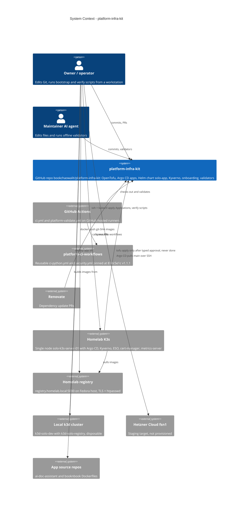

# 05 — C4 Context

ระบบในภาพคือ "platform-infra-kit" (Git repo ของ desired state + validators) และสิ่งที่อ่าน/เขียนมัน

Sources: `PRODUCT.md`, `.github/workflows/ci.yml`, `.github/workflows/platform-validate.yml`, `renovate.json`, `infra/platform/gitops/homelab/applications/*.yaml`, `infra/platform/gitops/homelab/README.md`, `infra/platform/bootstrap/homelab/README.md`, `infra/platform/bootstrap/local/create-cluster.sh`, `infra/platform/bootstrap/local/install-platform.sh`, `infra/platform/iac/envs/staging/fsn1/versions.tf`, `infra/platform/iac/scripts/apply-staging.sh`

ข้อสังเกต
- Homelab controllers (Kyverno, ESO, cert-manager, metrics-server) มาจาก `operations/platform/HOMELAB-URL-CATALOG.md` ("Controllers … kubectl only") และ `HOMELAB-OBSERVABILITY-RUNBOOK.md` — การติดตั้งบน Homelab ไม่มี script ใน repo นี้ (`install-platform.sh` เป็นของ local k3d)
- Registry อยู่บน Fedora `192.168.152.12`, K3s อยู่ที่ `192.168.152.114` (`bootstrap/homelab/README.md`)
- solo-empire ยังเป็นเจ้าของ registry ไฟล์บางชุด (`cloud-providers.yaml`, `paas-action-policy.json` ฯลฯ) ตาม `README.md`; `infra/platform/README.md` ยังบรรยาย Multi-PaaS control plane (`task paas:*`, `scripts/platform/paas_health.py`) ที่ **ไม่มีอยู่ใน repo นี้**

## Open questions

- Homelab Argo CD sync จาก repo นี้แล้วจริงหรือไม่ (README: "ยังไม่ได้ apply กับ cluster; ต้อง sync เองหลัง merge")
