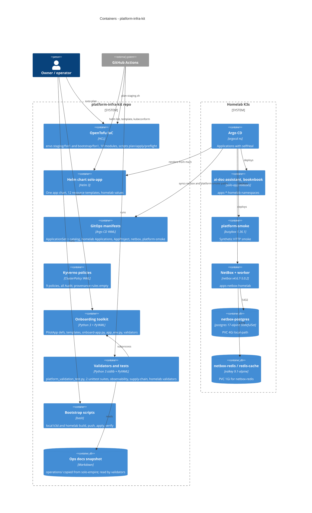

# 06 — C4 Container

"Container" ในที่นี้คือส่วนหลักของ repo (ไม่ใช่ process) และ workload ที่ Homelab Argo CD สร้างจากส่วนเหล่านั้น

Sources: repo tree (`find . -type f`), `infra/platform/helm/solo-app/templates/`, `infra/platform/gitops/**`, `infra/platform/policies/kyverno/*.yaml`, `infra/platform/onboarding/`, `infra/tests/platform/`, `infra/platform/iac/modules/`, `infra/platform/iac/envs/`, `infra/platform/gitops/homelab/netbox/*.yaml`, `infra/platform/gitops/homelab/platform-smoke/deployment.yaml`, `README.md` (operations snapshot)

IaC: modules 10 โฟลเดอร์ (`cost, database, dns, k3s-cluster, monitoring, network, node-pools, object-storage, registry, secrets`) และ env roots 2 ชุด (`bootstrap/fsn1`, `staging/fsn1`) + `production/README.md` (disabled)

## Open questions

- `operations/` ถือเป็น data ของ validator; ถ้าต้นฉบับใน solo-empire เปลี่ยน สำเนานี้ไม่อัปเดตเอง (README "แก้ทั้งสองที่")
