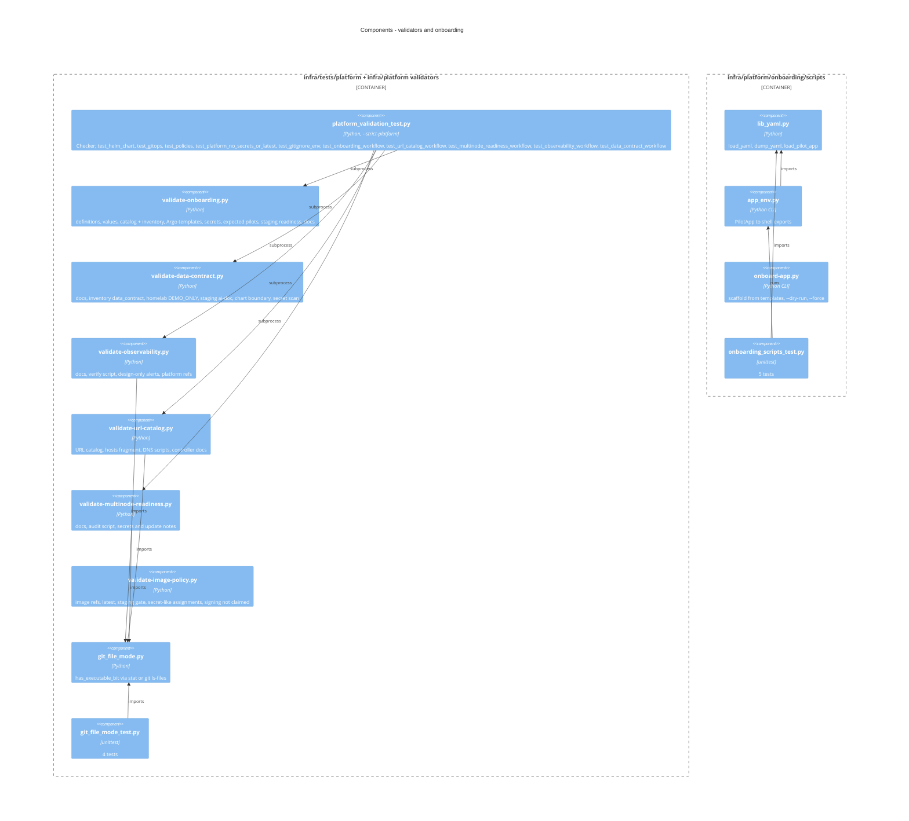

# 07 — C4 Component (validation toolkit)

ส่วนที่เป็นโค้ดจริงของ repo คือ Python validators และ onboarding helpers ภาพนี้แยก component ภายใน container "Validators and tests" + "Onboarding toolkit"

Sources: `infra/tests/platform/platform_validation_test.py` (function list lines 88–654, subprocess calls at 399, 454, 507, 563, 618), `infra/platform/onboarding/scripts/*.py`, `infra/platform/observability/validate-observability.py`, `infra/platform/homelab/validate-*.py`, `infra/platform/supply-chain/validate-image-policy.py`, `infra/platform/git_file_mode.py`, `infra/tests/platform/git_file_mode_test.py`, `infra/tests/platform/onboarding_scripts_test.py`

ผลรัน (2026-11-04, ในเครื่อง): platform 432 passed / 0 failures; onboarding 149; data-contract 68; observability 59; URL-catalog 52; multinode 48; supply-chain 10; unittest 4 + 5 OK

`validate-image-policy.py` ไม่ถูกเรียกจาก `platform_validation_test.py` (รันแยกใน job `supply-chain-contract`) `infra/scripts/platform/platform_output.py` (`configure_utf8_stdio`) ถูก import โดย `platform_validation_test.py`, `validate-onboarding.py`, `validate-data-contract.py`, `validate-observability.py` และ homelab validators ทั้งสอง (ไม่ได้วาดเส้นเพื่อลดความรก); `git_file_mode.py` ใช้ตรวจ exec bit ของ scripts ใน observability และ homelab validators

## Open questions

- ไม่มี
