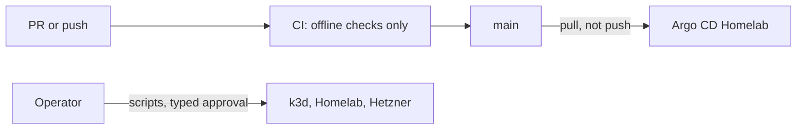

# ADR-0001 — Kit ตรวจแบบ offline และไม่ deploy เอง

- Status: accepted (retro-documented)
- Date: retro-documented 2026-11-04 (decision visible since repo split `e06bf74`, 2026-10-11)

## Context

repo นี้รวม IaC, GitOps, Helm, policy และ scripts ที่ถ้ารันผิดจะเปลี่ยน cluster หรือสร้าง cloud resource ที่มีค่าใช้จ่าย (Hetzner) เจ้าของเป็นคนเดียวและไม่มี staging จริง

## Decision

CI ทำเฉพาะการตรวจแบบ offline: Python validators, Helm lint/template, kubeconform, Trivy config, supply-chain guard และ `tofu plan` ด้วย `provision=false` + dummy token ไม่มี job ใดที่ `kubectl apply`, `helm install` หรือ `tofu apply` การเปลี่ยน cluster ทำโดย operator (scripts) หรือ Argo CD ที่อ่าน `main`

## Evidence

- `PRODUCT.md`: "It deploys nothing by itself"; "Nothing here has been applied to a cluster from CI"
- `.github/workflows/platform-validate.yml` header: "Validates Kubernetes platform assets without deploying anything"; job `tofu-fmt` step name "provision=false only, never applies"
- `infra/platform/iac/scripts/apply-staging.sh` requires typing `APPLY-STAGING-FSN1`
- `.github/workflows/ci.yml` `permissions: contents: read`

## Consequences

- ปลอดภัยต่อ cluster/cloud แต่ไม่มี CD: Homelab ได้ของใหม่เมื่อ Argo sync path จาก `main` เท่านั้น ส่วน Application CR และ image tag ต้อง apply มือ
- ไม่มี evidence อัตโนมัติว่า desired state ใน Git ตรงกับ cluster (ต้องรัน `verify-homelab-*.sh`)
