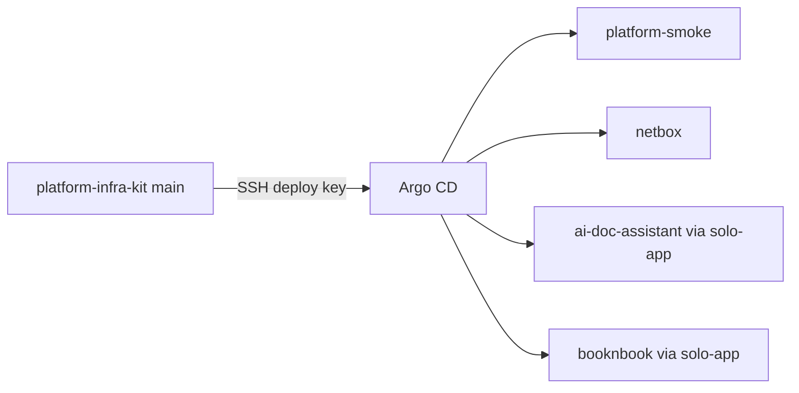

# ADR-0002 — Argo CD GitOps อ่าน repo นี้ (Homelab)

- Status: accepted (retro-documented)
- Date: retro-documented 2026-11-04 (repoURL switched to this repo in `5ff8962` / `155df13`, 2026-10-11/12)

## Context

Homelab K3s ต้องการ desired state ที่คงทนและตรวจสอบได้ แทนการ `kubectl apply` ซ้ำ ๆ

## Decision

ใช้ Argo CD Applications (project `solo-empire-apps`) ที่ชี้ `git@github.com:bookchaowalit/platform-infra-kit.git` `targetRevision: main` สำหรับ `platform-smoke-homelab`, `netbox-homelab`, `ai-doc-assistant-homelab`, `booknbook-homelab` ด้วย `automated.selfHeal: true`, `prune: false`, `CreateNamespace=true` เข้าถึง repo ด้วย read-only deploy key ใน secret `repo-solo-empire-github` (สร้างนอก Git)

## Evidence

- `infra/platform/gitops/homelab/applications/*.yaml` (`repoURL`, `syncPolicy`)
- `infra/platform/gitops/homelab/README.md` ("Repository access (durable)", "Apply order")
- `README.md` หมายเหตุ: "ยังไม่ได้ apply กับ cluster; ต้อง sync เองหลัง merge"

## Consequences

- push เข้า `main` ที่แตะ path ที่ sync (`helm/solo-app`, `gitops/homelab/netbox`, `gitops/homelab/platform-smoke`) จะถูก Argo นำไปใช้กับ Homelab (`.trivyignore.yaml` statement: "a manifest change deploys to the homelab")
- `prune: false` ทำให้ resource ที่ลบจาก Git ไม่ถูกลบใน cluster
- ApplicationSet ใน `gitops/applications/` เป็น design/example (`repoURL` `https://github.com/example/solo-platform-kit.git`) ไม่ใช่ตัวที่ Homelab ใช้
