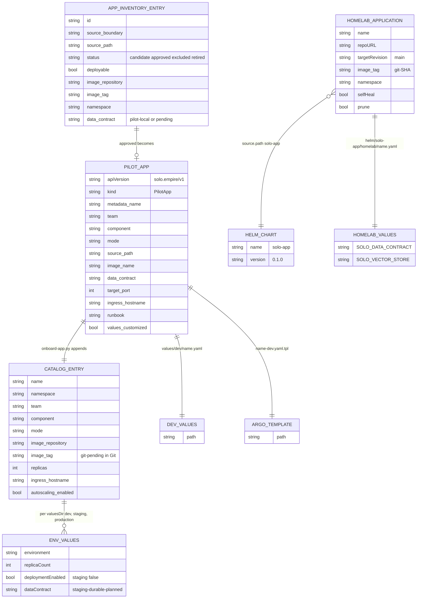
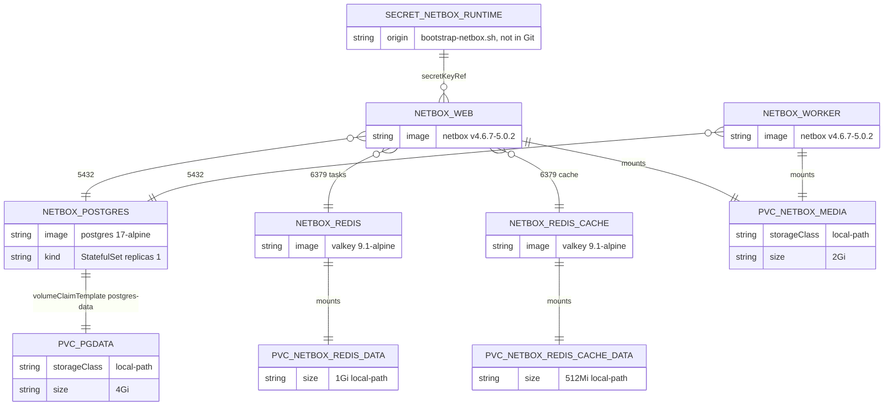

# 09 — ERD / data model

repo นี้ไม่มี database ของตัวเอง data ที่มีจริงแบ่งเป็นสองแบบ
1. **Config schema ใน Git** (YAML ที่ validators และ Argo CD อ่าน) — ภาพที่ 1
2. **Persisted stores ที่ manifests ของ repo นี้สร้างบน Homelab** (NetBox) — ภาพที่ 2

## 1. Config schema (YAML in Git)

Sources: `infra/platform/APP-INVENTORY.yaml`, `infra/platform/onboarding/apps/*.yaml`, `infra/platform/onboarding/scripts/onboard-app.py` (`write_definition`, `ensure_catalog_entry`), `infra/platform/gitops/applications/catalog/apps.yaml`, `infra/platform/gitops/applications/values/{dev,staging,production}/*.yaml`, `infra/platform/gitops/homelab/applications/*.yaml`, `infra/platform/helm/solo-app/Chart.yaml`, `infra/platform/helm/solo-app/homelab/ai-doc-assistant.yaml`

ตัวเลขปัจจุบัน: inventory มี approved 2 (`ai-doc-assistant`, `booknbook`) ที่เหลือ `candidate`; catalog มี 2 entries; `onboarding/apps/` มี 2 definitions

## 2. Persisted stores on Homelab (NetBox)

Sources: `infra/platform/gitops/homelab/netbox/netbox.yaml`, `postgres.yaml`, `valkey.yaml`, `networkpolicy.yaml`, `infra/platform/gitops/homelab/README.md` ("Boundary"), `operations/platform/HOMELAB-URL-CATALOG.md` ("5 devices + 1 VM seeded")

ตาราง NetBox ภายใน Postgres เป็น schema ของ NetBox upstream ไม่ได้นิยามใน repo นี้ จึงไม่วาด

## Stores อื่นที่ repo นี้อ้างถึง (ไม่ใช่ schema ของ repo)

| Store | ที่อยู่ | สถานะ |
|---|---|---|
| ai-doc-assistant chroma + uploads (Homelab) | `emptyDir` | DEMO_ONLY, หายเมื่อ pod restart (DATA-CONTRACT) |
| Homelab registry images | Fedora `REGISTRY_DATA_DIR` ค่าเริ่มต้น `/var/lib/solo-empire-registry` (credentials ใน `/etc/solo-empire-registry/`) | live ตาม URL catalog |
| Staging Postgres `ai_doc_assistant` | `iac/modules/database` บน Hetzner volume | not provisioned |
| OpenTofu state | local (scaffold) / S3 Hetzner Object Storage (design) | not provisioned |

## Open questions

- นโยบายลบ image เก่าใน Homelab registry ไม่มีใน repo
