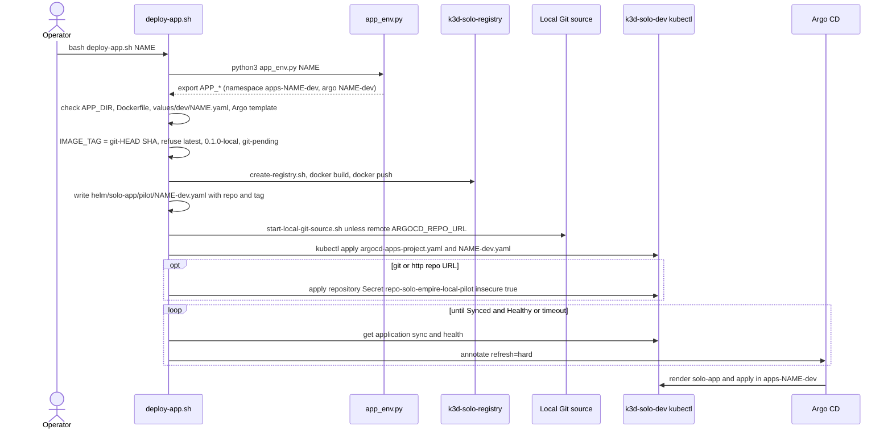
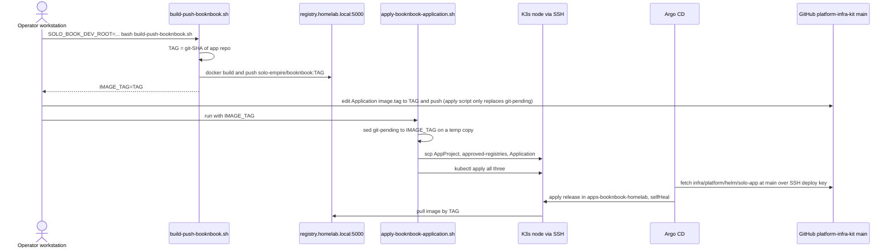
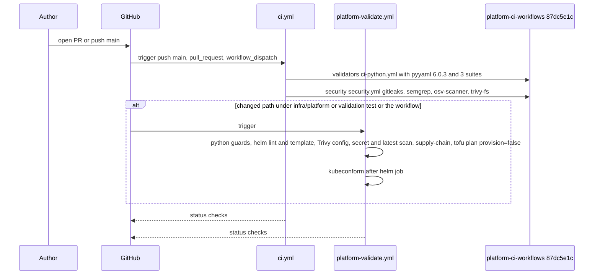
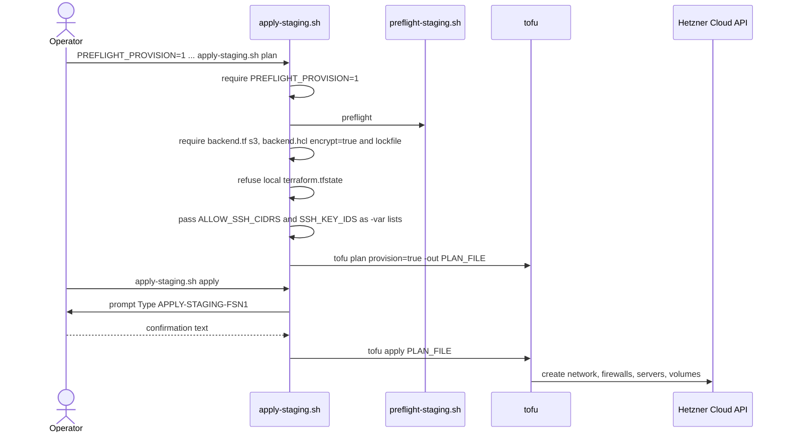

# 10 — Sequences

ไม่มี HTTP request path ของ repo เอง จึงเลือก 4 เส้นทางที่สำคัญที่สุดของ kit: local deploy, Homelab release, CI validation และ staging apply gate

## 1. `deploy-app.sh <name>` (local k3d dev)

Sources: `infra/platform/bootstrap/local/deploy-app.sh`, `infra/platform/onboarding/scripts/app_env.py`, `infra/platform/bootstrap/local/create-registry.sh`, `infra/platform/bootstrap/local/start-local-git-source.sh`

## 2. Homelab release of booknbook

Sources: `infra/platform/bootstrap/homelab/build-push-booknbook.sh`, `infra/platform/bootstrap/homelab/apply-booknbook-application.sh`, `infra/platform/gitops/homelab/applications/booknbook-homelab.yaml`, `infra/platform/gitops/homelab/README.md`

## 3. Pull request validation

Sources: `.github/workflows/ci.yml`, `.github/workflows/platform-validate.yml`, `platform-ci-workflows` `.github/workflows/ci-python.yml` and `security.yml` at `87dc5e1c`

## 4. Staging apply gate (`apply-staging.sh`)

Sources: `infra/platform/iac/scripts/apply-staging.sh`, `infra/platform/iac/scripts/preflight-staging.sh`, `infra/platform/iac/envs/staging/fsn1/main.tf`

การบังคับว่าต้องมี SSH CIDR/keys อยู่ใน `check` blocks ของ `main.tf` ซึ่งตามความหมายของ OpenTofu `check` แสดงผลเป็น warning ไม่หยุด plan/apply (ดู gap ใน [13](13-threat-model.md))

ขั้น "tofu apply" ยังไม่เคยเกิดขึ้น (PRODUCT.md, PRODUCTION-GAPS "not provisioned")

## Open questions

- ไม่มี
