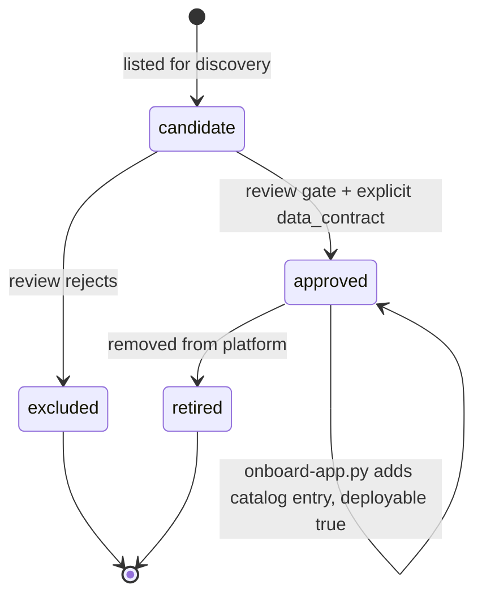
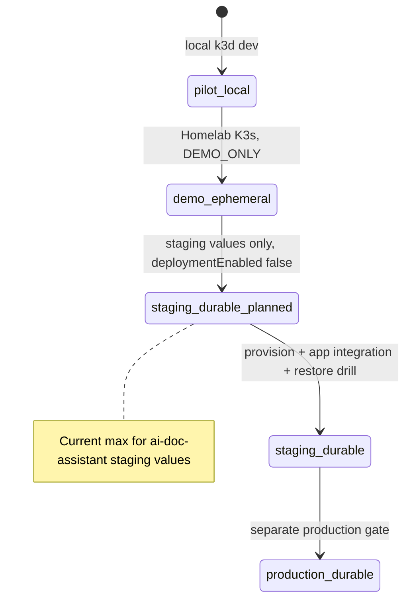
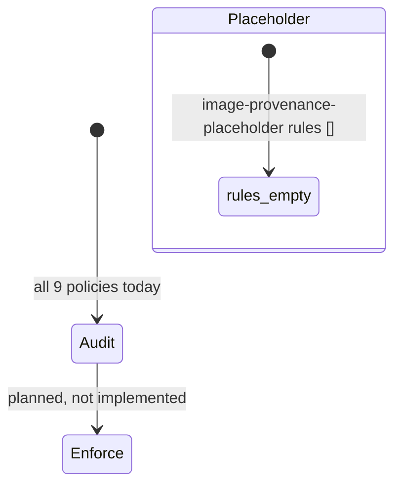
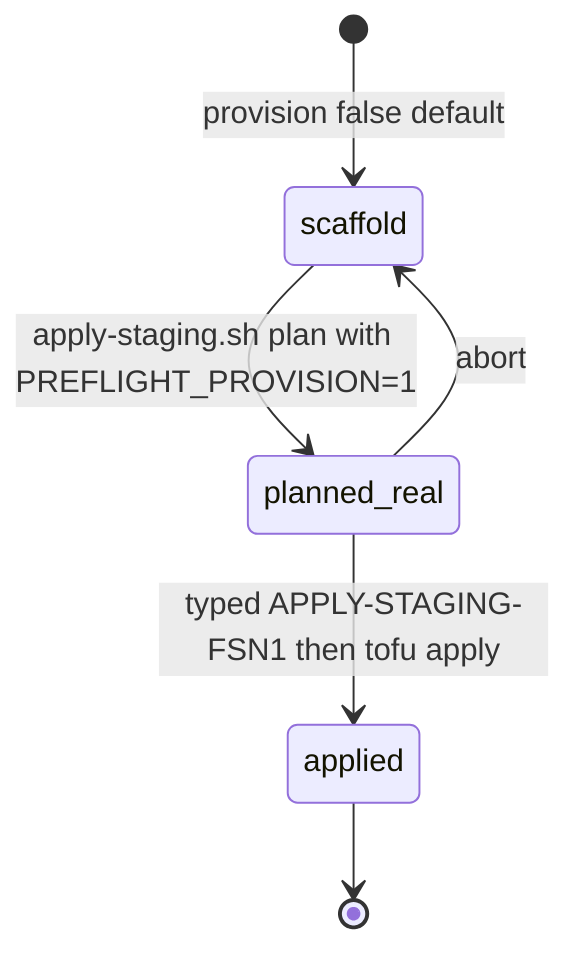

# 11 — State machines

ไม่มี entity ที่มี status ใน database แต่มี lifecycle fields ใน config ที่ validators บังคับใช้

## 1. Application lifecycle (`APP-INVENTORY.yaml` `status`)

Sources: `infra/platform/APP-INVENTORY.yaml` (`status_values`: candidate, approved, excluded, retired; header comment "Add an app to gitops/applications/catalog/apps.yaml only after its review gate and data contract are complete"), `infra/platform/DATA-CONTRACT.md` ("Approval gate"), `infra/platform/onboarding/README.md` ("Prerequisites")

ไม่มี script ที่เปลี่ยน `status` อัตโนมัติ การเปลี่ยนคือแก้ YAML มือ; ปัจจุบันมีเฉพาะ `approved` และ `candidate` ในไฟล์

## 2. Data contract promotion

Sources: `infra/platform/DATA-CONTRACT.md` ("Named data contracts", "Application integration gate"), `infra/platform/helm/solo-app/homelab/ai-doc-assistant.yaml` (`SOLO_DATA_CONTRACT: demo-ephemeral`), `infra/platform/gitops/applications/values/staging/ai-doc-assistant.yaml`

`staging_durable` และ `production_durable` เป็น **gap** (ยังไม่มี environment)

## 3. Kyverno policy mode

Sources: `infra/platform/policies/kyverno/*.yaml` (`validationFailureAction: Audit` on 8 policies; `image-provenance-placeholder.yaml` has `rules: []`), `infra/platform/README.md` ("Kyverno policies start in Audit mode")

## 4. Staging IaC provisioning flag

Sources: `infra/platform/iac/envs/staging/fsn1/variables.tf`, `infra/platform/iac/scripts/apply-staging.sh`

`applied` ไม่เคยเกิดขึ้น

## Open questions

- มีแผนเปลี่ยน Kyverno เป็น Enforce บน Homelab เมื่อไร (README บอกเพียง "Audit → Enforce")
