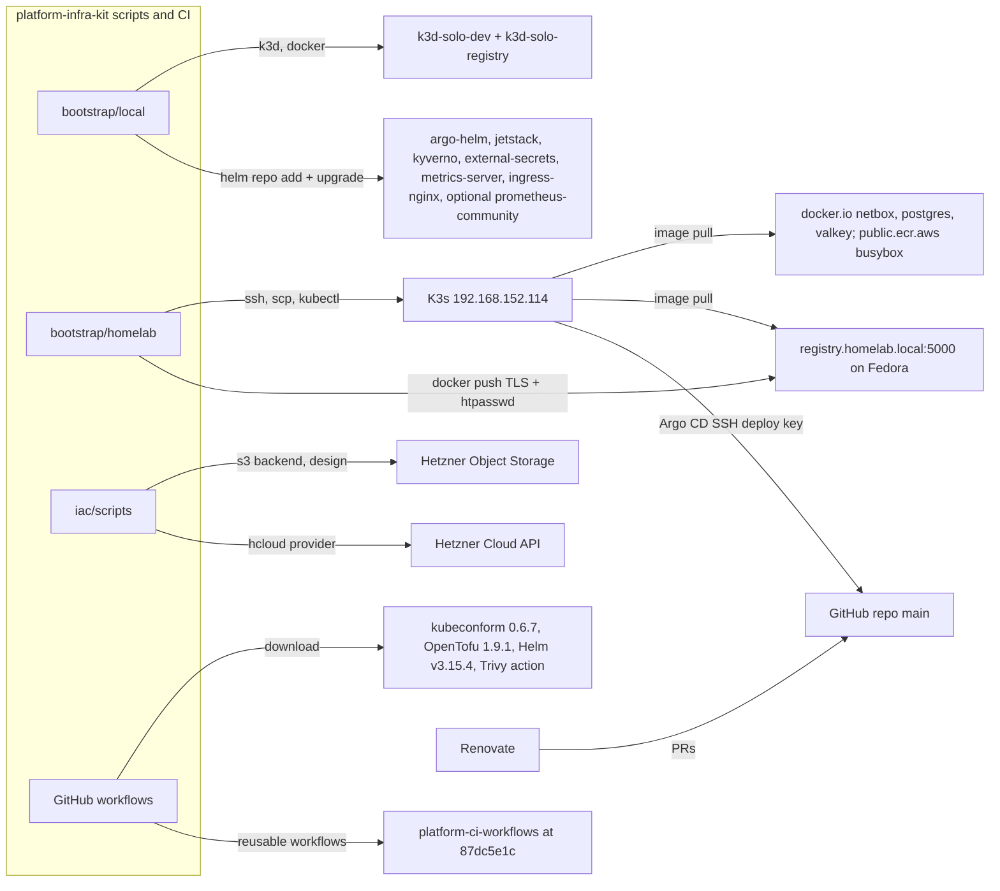

# 12 — API & integrations

repo นี้ไม่เปิด HTTP endpoint ใด ๆ "API" คือ CLI entry points และ external systems ที่ scripts/CI เรียก

## Entry points (CLI)

| Entry point | Inputs | Effect |
|---|---|---|
| `onboarding/scripts/onboard-app.py` | `--name`, `--source-path`, `--team`, `--component`, `--target-port`, `--data-contract`, `--dry-run`, `--force` | writes scaffold files |
| `onboarding/scripts/app_env.py NAME` | `onboarding/apps/NAME.yaml` | prints `export APP_*` |
| `bootstrap/local/deploy-app.sh NAME` | env `IMAGE_TAG`, `ARGOCD_REPO_URL`, `pilot.env` | build/push + apply to k3d |
| `bootstrap/homelab/*.sh` | env `K3S_HOST` (default `192.168.152.114`), `K3S_USER`, `REGISTRY_HOST`, `SOLO_BOOK_DEV_ROOT`, `IMAGE_TAG` | build/push, SSH apply, verify |
| `iac/scripts/{preflight,pre-apply-audit,plan,apply}-staging.sh` | env `PREFLIGHT_PROVISION`, `ALLOW_SSH_CIDRS`, `SSH_KEY_IDS`, `HCLOUD_TOKEN` | tofu plan/apply |
| Validators (8 scripts) | repo files | exit code + pass/fail lines |

## External integrations

Sources: `infra/platform/bootstrap/local/install-platform.sh`, `infra/platform/bootstrap/local/deploy-app.sh` (ingress-nginx), `infra/platform/bootstrap/local/create-cluster.sh`, `infra/platform/bootstrap/homelab/*.sh`, `infra/platform/gitops/homelab/netbox/*.yaml`, `infra/platform/gitops/homelab/platform-smoke/deployment.yaml`, `infra/platform/iac/envs/staging/fsn1/versions.tf`, `providers.tf`, `backend.hcl.example`, `.github/workflows/*.yml`, `renovate.json`

## Kubernetes CRDs ที่ chart และ manifests ใช้

| CRD | ใช้ที่ | ติดตั้งจาก |
|---|---|---|
| `argoproj.io` Application / ApplicationSet / AppProject | `gitops/` | Argo CD |
| `external-secrets.io` ExternalSecret | `templates/externalsecret.yaml` | external-secrets chart |
| `keda.sh` ScaledObject | `templates/keda-scaledobject.yaml` (`keda.enabled: false` default) | ไม่มี script ติดตั้ง KEDA — gap |
| `monitoring.coreos.com` ServiceMonitor / PrometheusRule | `templates/servicemonitor.yaml`, `observability/alerts/homelab-alerts.yaml` (design only) | optional kube-prometheus-stack (local only) |
| `gateway.networking.k8s.io` HTTPRoute | `templates/httproute.yaml` (`gateway.enabled: false`) | ไม่มี script ติดตั้ง — gap |
| `kyverno.io` ClusterPolicy | `policies/kyverno/` | kyverno chart |

kubeconform ใน CI ข้าม `ExternalSecret,ScaledObject,ServiceMonitor,HTTPRoute` (`platform-validate.yml`)

## Not in this repo

`infra/platform/README.md` อธิบาย Render/Vercel/Neon/Cloudflare/RunPod/Supabase/Upstash adapters, `/api/paas`, `/api/cloud/usage` และ `task paas:*` — โค้ดเหล่านั้น (`scripts/platform/paas_health.py` ฯลฯ) **ไม่อยู่ใน repo นี้** (มีเพียง `infra/scripts/platform/platform_output.py`) จึงไม่นับเป็น integration ของ repo

## Open questions

- ควรตัดส่วน Multi-PaaS ออกจาก `infra/platform/README.md` หรือชี้ไป repo ที่เป็นเจ้าของ
