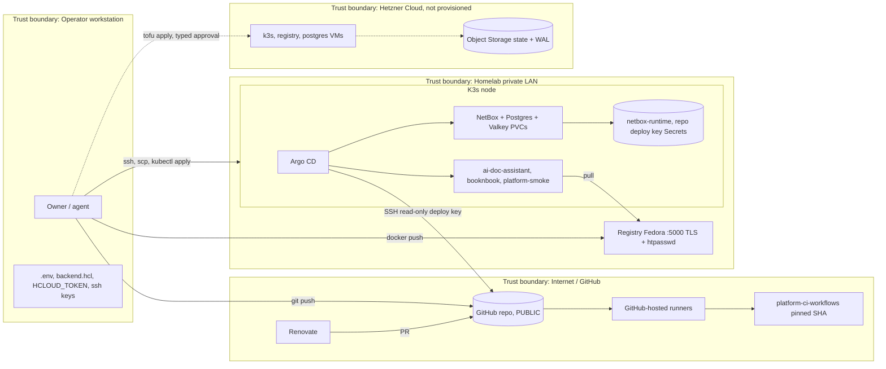

# 13 — Threat model (DFD + STRIDE)

ขอบเขต: repo (public), CI, เส้นทาง Git → Argo CD → Homelab K3s, registry, NetBox data และ IaC staging (ยังไม่ provision)

Sources: `infra/platform/gitops/homelab/README.md`, `infra/platform/gitops/homelab/argocd/solo-empire-apps-project.yaml`, `infra/platform/gitops/homelab/applications/*.yaml`, `infra/platform/gitops/homelab/netbox/*.yaml`, `infra/platform/bootstrap/homelab/README.md`, `infra/platform/iac/envs/staging/fsn1/*.tf`, `.github/workflows/*.yml`, `gh repo view` (visibility PUBLIC, 2026-11-04)

## STRIDE per element

| Element | Threat (STRIDE) | Mitigation found in repo | Gap |
|---|---|---|---|
| GitHub repo | **T**ampering: a push to `main` reaches Homelab via Argo selfHeal | PR #2 used a PR; CI on push and PR | `main` has no branch protection and no rulesets (`gh api …/branches/main/protection` → 404 "Branch not protected", `…/rulesets` → `[]`, 2026-11-04); direct pushes to `main` happen (see 18) |
| GitHub repo | **I**nfo disclosure: public repo | secrets out-of-band; gitleaks (`security.yml`); secret scans in `platform_validation_test.py`, `validate-data-contract.py`, `validate-onboarding.py` | private LAN IPs/hostnames (`192.168.152.114`, `.12`, `*.homelab.local`) are published; README says repo is private (mismatch) |
| CI runners | **T**ampering of tools | Actions pinned to SHAs (`actions/checkout@fbc6f39…`, `azure/setup-helm@9bc31f4…`, `trivy-action@ed142fd…`); `permissions: contents: read` | kubeconform and OpenTofu downloaded with `curl` without checksum verification (`platform-validate.yml`); `pip install --user pyyaml` unpinned in `platform-validate.yml` |
| Argo CD AppProject `solo-empire-apps` | **E**levation | Applications set `prune: false`; deploy key read-only (README) | `sourceRepos` includes `'*'`, `'file://*'`, `'http://*'`; destinations `apps-*`; `namespaceResourceWhitelist` group/kind `'*'` |
| Admission (Kyverno) | **E**levation / **T**ampering via images | 9 ClusterPolicies (non-root, read-only rootfs, no privileged, no host namespaces, resources, labels, no latest, approved registries) | all `Audit`, none `Enforce`; `approved-registries` pattern omits `docker.io/*` that NetBox, Postgres and Valkey use; image provenance `rules: []` |
| App workloads (`solo-app`) | **E**levation | chart defaults: `runAsNonRoot`, UID 65532, `readOnlyRootFilesystem`, drop ALL, `automount: false`, NetworkPolicy | default egress allows any namespace on 443 and 5432 (`values.yaml`) |
| Homelab Ingress | **I**nfo disclosure / **S**poofing | private LAN hosts only (`gitops/homelab/README.md` Boundary) | `tls: []` in homelab values; URL catalog lists HTTP only |
| NetBox | **T** / **D**enial of service on data | NetworkPolicies for web, worker, data; secret in `netbox-runtime` | writable root FS accepted (`.trivyignore.yaml` KSV-0014); single replica, `local-path` PVCs, no backup (see 14) |
| Registry | **S**poofing / **T** | TLS + htpasswd, credentials only under `/etc/solo-empire-registry/` on Fedora (homelab README); returns 401 without auth (URL catalog) | no image signing or digest pinning in Homelab (supply-chain README "Audit/placeholder") |
| Local k3d dev | **T** | disposable cluster | repo Secret `insecure: "true"` for local Git; registry `insecure_skip_verify: true`; metrics-server `--kubelet-insecure-tls` (local only) |
| IaC / Hetzner | **E** / **I** | `provision=false` default; typed `APPLY-STAGING-FSN1`; registry no public port; remote state `encrypt = true` + lock required by `apply-staging.sh`; sensitive outputs | SSH CIDR/key rules are `check` blocks (OpenTofu `check` reports, does not stop apply); nodes firewall opens 80/443 to `0.0.0.0/0` by design |
| Operator workstation | **S** / **R**epudiation | `ssh -o BatchMode=yes`; secrets via env | no audit log of who ran `apply-*`/`deploy-app.sh` (only shell history) |

Sources: `.github/workflows/platform-validate.yml`, `.github/workflows/ci.yml`, `.trivyignore.yaml`, `infra/platform/policies/kyverno/*.yaml`, `infra/platform/helm/solo-app/values.yaml`, `infra/platform/helm/solo-app/homelab/*.yaml`, `infra/platform/bootstrap/local/{deploy-app,create-registry,install-platform}.sh`, `infra/platform/iac/modules/network/main.tf`, `infra/platform/iac/envs/staging/fsn1/main.tf`, `infra/platform/iac/scripts/apply-staging.sh`, `infra/platform/supply-chain/README.md`, `operations/platform/HOMELAB-URL-CATALOG.md`

## Open questions

- ต้องการ branch protection / required checks บน `main` หรือไม่ เพราะ push = เปลี่ยน Homelab
- AppProject `sourceRepos: '*'` ตั้งใจไว้เพื่อ local pilot; ควรแยก project ของ Homelab ให้แคบลงหรือไม่
- ยอมรับการเผยแพร่ IP/hostname ของ LAN ใน repo สาธารณะหรือไม่
