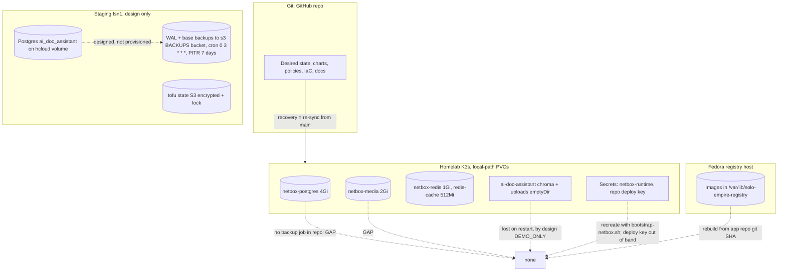

# 14 — Backup & DR

repo นี้ไม่มี runtime แต่ manifests ของมันสร้าง persisted data บน Homelab และออกแบบ backup สำหรับ staging ที่ยังไม่มี

## Data inventory and backup reality

Sources: `infra/platform/gitops/homelab/netbox/{postgres,netbox,valkey}.yaml`, `infra/platform/helm/solo-app/homelab/ai-doc-assistant.yaml`, `infra/platform/DATA-CONTRACT.md`, `infra/platform/bootstrap/homelab/bootstrap-netbox.sh`, `infra/platform/bootstrap/homelab/install-registry-on-fedora.sh` (`REGISTRY_DATA_DIR`), `infra/platform/iac/modules/database/main.tf` (`pitr` locals, `pitr_plan`), `infra/platform/iac/modules/database/variables.tf` (`backup_cron`), `infra/platform/iac/envs/staging/fsn1/variables.tf` (`pitr_retention_days` 7), `infra/platform/iac/README.md` (Remote state)

| Data | Where | Backup in repo | Restore path | RTO / RPO |
|---|---|---|---|---|
| Git desired state | GitHub | GitHub itself (no extra mirror in repo) | clone + Argo re-sync | not defined |
| NetBox Postgres | K3s `local-path` PVC 4Gi | **none** (no CronJob, no pg_dump script) | none documented | not defined |
| NetBox media / Valkey | `local-path` PVCs | **none** | none | not defined |
| ai-doc-assistant vectors/uploads (Homelab) | `emptyDir` | none, by contract DEMO_ONLY | re-ingest | data loss expected (HOMELAB-OBSERVABILITY-RUNBOOK §5.2) |
| Homelab registry images | Fedora `/var/lib/solo-empire-registry` | none | rebuild `git-<sha>` from app repo | not defined |
| Staging Postgres (planned) | Hetzner volume | design: WAL archive + base backup, tool "pgBackRest-or-wal-g", restore drill every 30 days | `operations/runbooks/STAGING-DATA-BACKUP-RESTORE.md` §4 | RTO drill target **< 2 hours** operator time; RPO ≈ WAL ship lag (runbook §2, §4.4) |
| OpenTofu state (planned) | Hetzner Object Storage, versioning on | bucket versioning (design) | `docs/STATE-BACKEND.md` | not defined |

Reused: staging backup/restore design คือ [`operations/runbooks/STAGING-DATA-BACKUP-RESTORE.md`](../../operations/runbooks/STAGING-DATA-BACKUP-RESTORE.md) (snapshot copy) ไม่คัดลอกมาที่นี่

หมายเหตุ: `operations/platform/HOMELAB-K3S-RUNBOOK.md` บันทึก backup drill ของ local SQLite control plane (2026-08-20) แต่ scripts เหล่านั้น "retired 2026-10-11" และไม่เกี่ยวกับ NetBox

## Gaps

- NetBox เป็น data ตัวเดียวที่มีจริงและไม่มี backup/restore ใด ๆ ใน repo
- ไม่มี restore drill ที่ทำจริงสำหรับ staging (PRODUCTION-GAPS "Contract ready / no live restore drill")
- `local-path` ผูก data กับดิสก์ของ node เดียว (single-node K3s, URL catalog)

## Open questions

- NetBox inventory ต้องการ backup หรือยอมรับให้ seed ใหม่ด้วย `netbox-seed.py`
- RTO/RPO ของ Homelab ต้องกำหนดหรือไม่ (SLO-SLI-BASELINE ไม่ระบุ)
