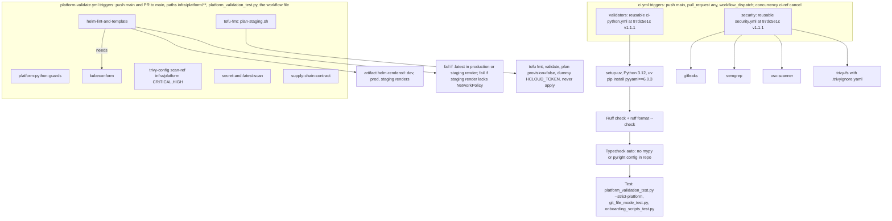

# 15 — CI/CD pipeline

สอง workflow ใน `.github/workflows/` ทั้งคู่ไม่มี deploy job (CI only) runner เป็น GitHub-hosted (`ubuntu-latest` / reusable default `ubuntu-24.04`) เพราะ repo เป็น public (comment ใน `ci.yml`)

Sources: `.github/workflows/ci.yml`, `.github/workflows/platform-validate.yml`, `.trivyignore.yaml`, `ruff.toml`, `platform-ci-workflows` `.github/workflows/ci-python.yml` and `security.yml` at commit `87dc5e1c7e0416886a6371d5a101bb2ccba38edd` (local clone `~/solo-empire/.../platform-ci-workflows`)

`platform-python-guards` steps: platform validation test, `validate-onboarding.py`, `validate-observability.py`, `bash -n verify-homelab-observability.sh`, `validate-multinode-readiness.py`, `bash -n audit-multinode-readiness.sh`, `validate-url-catalog.py`, `bash -n sync-homelab-dns.sh verify-homelab-urls.sh`

## Recent results (`gh run list`, 2026-11-04)

| Workflow | Event / branch | Runs | Failures |
|---|---|---|---|
| CI | push `main` | 3 (`7e1b450`, `25a0838`, `f80262a`) | 1 (`25a0838`, job `validators / python` — fixed by `f80262a` "ruff EXE001") |
| CI | pull_request `ci/devsecops-phase1` | 2 | 0 |
| Platform Validate | push `main` | 8 | 7 (`e06bf74` … `856a6ec`, 2026-10-11 → 10-13; on `856a6ec` only `Trivy Config Scan` failed; first green `7e1b450` after `.trivyignore.yaml`) |
| Shared infrastructure acceptance | PR #1 branch | 12 | 0 — workflow exists only on the open PR branch, not on `main` |

## CD

ไม่มี CD workflow การนำไปใช้คือ Argo CD Homelab pull จาก `main` (ดู [16](16-deployment.md), [18](18-git-release-workflow.md)) — gap: ไม่มี job ใดตรวจว่า Homelab sync สำเร็จหลัง merge

## Open questions

- `platform-validate.yml` ไม่ได้ถูกเรียกเมื่อแก้แค่ `infra/tests/platform/onboarding_scripts_test.py` หรือ `git_file_mode_test.py` (ไม่อยู่ใน path filter) — ตั้งใจหรือไม่ (ci.yml ครอบคลุมอยู่แล้ว)
