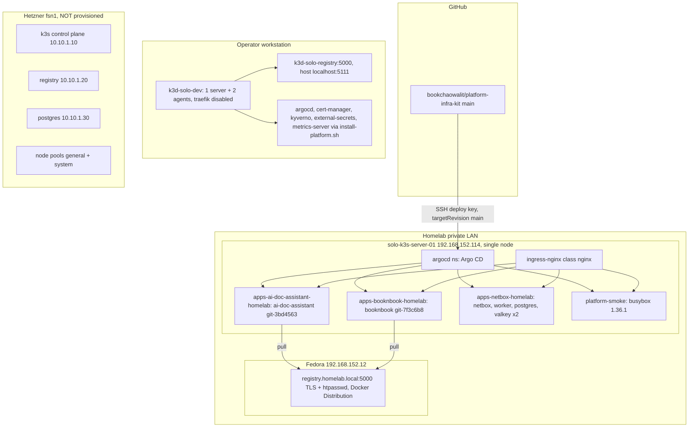

# 16 — Deployment

repo นี้ไม่มี hosted runtime ของตัวเอง ภาพแสดง environment ที่ repo นี้เป็น source of desired state

Sources: `infra/platform/gitops/homelab/applications/*.yaml` (namespaces, image tags), `infra/platform/gitops/homelab/netbox/*.yaml`, `infra/platform/gitops/homelab/platform-smoke/*.yaml`, `infra/platform/helm/solo-app/homelab/*.yaml` (`className: nginx`, hosts), `infra/platform/bootstrap/homelab/README.md`, `infra/platform/bootstrap/local/create-cluster.sh`, `infra/platform/bootstrap/local/install-platform.sh`, `infra/platform/ENVIRONMENT-CONTRACT.md` §2 (registry host port 5111), `infra/platform/iac/envs/staging/fsn1/main.tf` (private IPs)

## Domains / hosts

| Host | Target | TLS |
|---|---|---|
| `ai-doc-assistant.homelab.local` | K3s ingress `192.168.152.114:80` | none (`tls: []`) |
| `booknbook.homelab.local` | same | none |
| `netbox.homelab.local` | same | none in manifest |
| `platform-smoke.local` | same | none |
| `registry.homelab.local` | `192.168.152.12:5000` | TLS (internal CA) |
| `<app>.dev.local` | k3d host port 18080 | optional / none |
| `<app>.staging.<domain>` | planned | cert-manager issuer placeholder |

Sources: `infra/platform/gitops/homelab/README.md` (Boundary), `operations/platform/HOMELAB-URL-CATALOG.md`, `infra/platform/ENVIRONMENT-CONTRACT.md` §4

## Environments

| Env | Status (from repo) | Deploy mechanism |
|---|---|---|
| local / dev (k3d) | disposable, operator-created | `deploy-app.sh` → Argo Application `NAME-dev` |
| homelab | live per URL catalog (healthz 200, FAIL=0) | Argo CD from this repo `main`; Applications applied by SSH |
| staging | not provisioned; values `deploymentEnabled: false` | none |
| production | disabled (`iac/envs/production/README.md`, ApplicationSet element commented out) | none |

## Open questions

- Argo CD UI เข้าถึงด้วย port-forward เท่านั้น (URL catalog) — ยังเป็นเช่นนั้นหรือไม่
- Homelab ingress-nginx ติดตั้งด้วยวิธีใด (ไม่มี script ใน repo สำหรับ Homelab)
