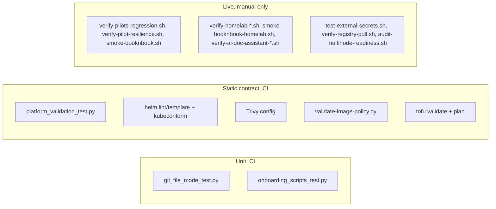

# 17 — Test coverage matrix

ระดับทดสอบที่มีจริงใน repo
- **unit**: `unittest` suites (`git_file_mode_test.py` 4 tests, `onboarding_scripts_test.py` 5 tests)
- **static / offline contract**: validators ที่อ่านไฟล์ (`platform_validation_test.py` 432 checks และ validators ย่อย) + Helm render, kubeconform, Trivy, tofu plan ใน CI
- **live / e2e (manual)**: bash scripts ที่ operator รันกับ cluster จริง (ไม่อยู่ใน CI, CI ทำแค่ `bash -n` บางตัว)

ไม่มีการวัด coverage (ไม่ได้ส่ง `coverage-threshold` ใน `ci.yml`)

Sources: `infra/tests/platform/*.py`, `infra/platform/**/validate-*.py`, `.github/workflows/*.yml`, `infra/platform/bootstrap/{local,homelab}/*.sh`

| Feature / area | Unit | Static (CI) | Live (manual script) | Gap |
|---|---|---|---|---|
| Helm chart `solo-app` | — | `test_helm_chart`, helm lint, template dev/prod/staging, kubeconform | via Argo on k3d/Homelab | no `helm unittest`; kubeconform skips 4 CRD kinds |
| GitOps manifests | — | `test_gitops` | `verify-homelab-platform.sh` | homelab Applications not schema-validated by kubeconform |
| Kyverno policies | — | `test_policies`, YAML parse in kubeconform job | PolicyReport via `verify-homelab-observability.sh` | no Kyverno CLI test of policies against fixtures |
| No secrets / no latest | — | `test_platform_no_secrets_or_latest`, `secret-and-latest-scan`, gitleaks | — | — |
| Onboarding scaffold `onboard-app.py` | — | `test_onboarding_workflow` (file presence + `validate-onboarding.py`) | — | no unit test runs `onboard-app.py --dry-run` |
| `app_env.py`, `lib_yaml.py` | `onboarding_scripts_test.py` | — | used by `deploy-app.sh` | — |
| Data contract | — | `test_data_contract_workflow` → `validate-data-contract.py` (68) | `verify-ai-doc-assistant-data-readiness.sh` | — |
| Observability docs/scripts | — | `test_observability_workflow` → `validate-observability.py` (59), `bash -n` | `verify-homelab-observability.sh` | alerts are design-only, never evaluated |
| Homelab URL catalog / DNS | — | `test_url_catalog_workflow` (52), `bash -n` | `verify-homelab-urls.sh`, `sync-homelab-dns.sh DRY_RUN=1` | — |
| Multi-node readiness | — | `test_multinode_readiness_workflow` (48), `bash -n` | `audit-multinode-readiness.sh` | — |
| Supply-chain policy | — | `validate-image-policy.py` (10) in `platform-validate.yml` only | — | not in `ci.yml` |
| Exec bit helper | `git_file_mode_test.py` | — | — | — |
| IaC staging | — | `plan-staging.sh` (fmt, validate, plan `provision=false`) | `preflight-staging.sh`, `pre-apply-audit.sh` | no `tofu test`; `provision=true` path never exercised; bootstrap root not planned in CI |
| Local deploy `deploy-app.sh` | — | — | the script itself | no `bash -n` or shellcheck in CI |
| NetBox manifests | — | Trivy config (KSV-0014 ignored) | `bootstrap-netbox.sh` | no backup/restore test |

Sources: `infra/tests/platform/platform_validation_test.py` (functions `test_*`), `infra/tests/platform/git_file_mode_test.py`, `infra/tests/platform/onboarding_scripts_test.py`, `.github/workflows/platform-validate.yml`, `.github/workflows/ci.yml`, validator outputs run locally 2026-11-04

## Open questions

- ต้องการ shellcheck สำหรับ bash scripts 34 ไฟล์ใน `bootstrap/` และ 4 ไฟล์ใน `iac/scripts/` หรือไม่
