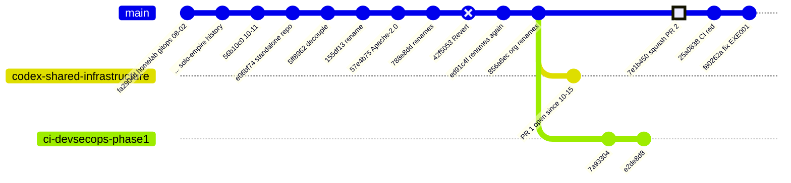
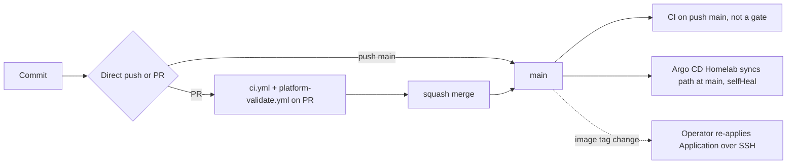

# 18 — Git & release workflow

- Branch เดียวที่ใช้ปล่อยคือ `main`; ไม่มี tag หรือ GitHub release
- History ก่อน 2026-10-11 มาจาก `git subtree split` ของ `solo-empire/infra/platform/` (README "พร้อมประวัติ git") repo แยกตัวที่ `e06bf74`
- หลังแยก: ส่วนใหญ่ commit ตรงเข้า `main`; มี PR ที่ merge แล้ว 1 อัน (#2, squash บน GitHub → `7e1b450`, committer `GitHub`) และ PR เปิดค้าง 1 อัน (#1)
- `main` ไม่มี branch protection / ruleset (ดู [13](13-threat-model.md))
- "Release" = Argo CD Homelab อ่าน `targetRevision: main` ทันทีที่ sync รอบถัดไป

Sources: `git log --first-parent origin/main`, `git log --merges origin/main` (1 merge, `a727d66` from solo-empire era), `gh pr list --state all` (PR #1 OPEN `codex/shared-infrastructure-20261015`; PR #2 MERGED 2026-10-17T09:44:12Z), `gh run list` (head SHAs of PR #2 runs), `README.md`

## Path to Homelab

Sources: `.github/workflows/*.yml`, `infra/platform/gitops/homelab/applications/*.yaml`, `infra/platform/bootstrap/homelab/apply-*-application.sh`

CI บน push `main` ไม่ได้กั้นอะไร: Argo CD ไม่รอผล CI (ไม่มี config ใดเชื่อมสองอย่างนี้)

## Open questions

- ต้องการให้ Homelab ใช้ tag/branch แยก (เช่น `homelab`) แทน `main` เพื่อให้ CI เป็น gate หรือไม่
