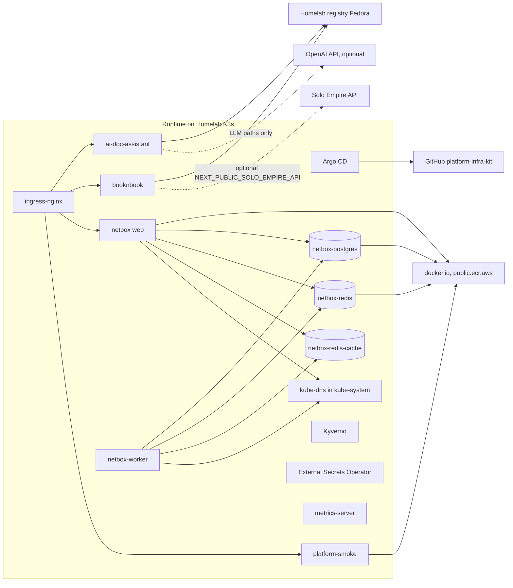

# 19 — Service dependency map

dependency ของ workload ที่ repo นี้ประกาศ (Homelab) และของ toolchain (operator + CI)

Sources: `infra/platform/gitops/homelab/netbox/networkpolicy.yaml` (egress to postgres 5432, redis and redis-cache 6379, kube-system 53), `infra/platform/gitops/homelab/netbox/*.yaml` (images), `infra/platform/gitops/homelab/platform-smoke/deployment.yaml`, `infra/platform/gitops/homelab/applications/*.yaml`, `infra/platform/APP-INVENTORY.yaml` (booknbook notes: optional `NEXT_PUBLIC_SOLO_EMPIRE_API`), `operations/platform/HOMELAB-URL-CATALOG.md` (ai-doc-assistant "optional OpenAI for LLM paths only"; controllers list), `infra/platform/bootstrap/homelab/README.md`

## Toolchain dependencies

| Consumer | Depends on | Pinned? |
|---|---|---|
| `ci.yml` | `platform-ci-workflows` reusable workflows | SHA `87dc5e1c…` (v1.1.1) |
| `ci.yml` validators | Python 3.12, `pyyaml==6.0.3` via uv | yes |
| `platform-validate.yml` | `actions/checkout`, `azure/setup-helm`, `actions/upload-artifact`, `aquasecurity/trivy-action` | SHA pins |
| `platform-validate.yml` | Helm v3.15.4, kubeconform 0.6.7, OpenTofu 1.9.1 | version pins, no checksum |
| `platform-validate.yml` | `pyyaml` via `pip install --user` | unpinned |
| OpenTofu staging | `hetznercloud/hcloud`, `hashicorp/random`, `tls`, `local` | `.terraform.lock.hcl` |
| OpenTofu bootstrap | `hashicorp/null`, `local` | `.terraform.lock.hcl` |
| `install-platform.sh` | charts argo-cd, cert-manager, kyverno, external-secrets, metrics-server, optional kube-prometheus-stack | chart versions not pinned (no `--version`) |
| Validators | PyYAML (`lib_yaml.py` exits if missing) | — |
| Homelab app images | app source repos built by `build-push-*.sh` | `git-<sha>` tags |
| Dependency updates | Renovate (`config:recommended`, `helpers:pinGitHubActionDigests`) | — |

Sources: `.github/workflows/*.yml`, `infra/platform/iac/envs/*/versions.tf`, `infra/platform/iac/envs/*/.terraform.lock.hcl`, `infra/platform/bootstrap/local/install-platform.sh`, `infra/platform/onboarding/scripts/lib_yaml.py`, `renovate.json`

## Open questions

- ai-doc-assistant/booknbook มี dependency runtime อื่นนอกจากที่ inventory/URL catalog ระบุหรือไม่ (อยู่ใน repo ของแอป ไม่ได้อ่าน)
