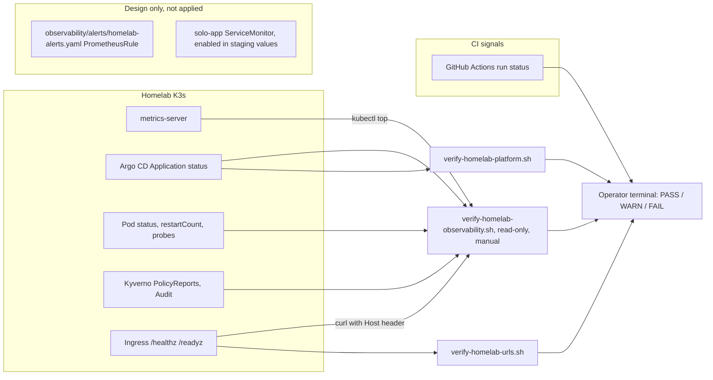

# 20 — Observability

repo นี้ไม่มี runtime จึงไม่มี Sentry, PostHog, heartbeat หรือ uptime Worker ของตัวเอง ([PRODUCT.md](../../PRODUCT.md): "No runtime of its own, so no Sentry") สัญญาณที่มีจริงคือ (1) ผล CI และ (2) scripts อ่านอย่างเดียวที่ operator รันกับ Homelab ตาม runbook

Reused: SLI/SLO และขอบเขตการ monitor อยู่ใน [`operations/platform/HOMELAB-OBSERVABILITY-RUNBOOK.md`](../../operations/platform/HOMELAB-OBSERVABILITY-RUNBOOK.md) และ [`operations/platform/SLO-SLI-BASELINE.md`](../../operations/platform/SLO-SLI-BASELINE.md) (snapshot copies)

Sources: `PRODUCT.md`, `operations/platform/HOMELAB-OBSERVABILITY-RUNBOOK.md` §1, §3, §4, `operations/platform/SLO-SLI-BASELINE.md`, `infra/platform/observability/alerts/homelab-alerts.yaml`, `infra/platform/observability/alerts/README.md`, `infra/platform/helm/solo-app/templates/servicemonitor.yaml`, `infra/platform/gitops/applications/values/staging/common.yaml` (`serviceMonitor.enabled: true`), `infra/platform/PLATFORM-SERVICES.yaml` (metrics-server "Live on Homelab K3s"; Prometheus/Grafana "Docker Compose Lab only")

## What is watched (Homelab SLIs, measured only when a script runs)

| SLI | Target (SLO-SLI-BASELINE) | Collected by |
|---|---|---|
| healthz/readyz smoke | 100% per verify run | verify scripts (curl) |
| Argo apps | Synced + Healthy | verify scripts (kubectl) |
| Unexpected restarts | 0 during baseline | verify scripts |
| CrashLoopBackOff / ImagePullBackOff | 0 cluster-wide | verify scripts |
| Node memory | warn ≥ 75%, critical ≥ 85% | `kubectl top nodes` |
| Node CPU | warn ≥ 70%, critical ≥ 85% | `kubectl top nodes` |

## Gaps

- ไม่มีการเก็บ metric/log ต่อเนื่อง ไม่มี alert ส่งออกไปที่ใด (Telegram/อีเมล/pager) — alert rules เป็น design-only และ `ArgoApplicationDegraded` ใช้ `expr: vector(0)` placeholder
- ไม่มี heartbeat ว่า Argo sync ของ Homelab สำเร็จหลัง push `main`
- Homelab "does not claim production SLAs, 24×7 paging" (runbook §1)

## Open questions

- Homelab ถูกรวมใน uptime Worker หรือ posture monitor กลางหรือไม่ (ไม่มีการอ้างถึงใน repo นี้; hosts เป็น `.local` ซึ่งเข้าจากภายนอกไม่ได้)
