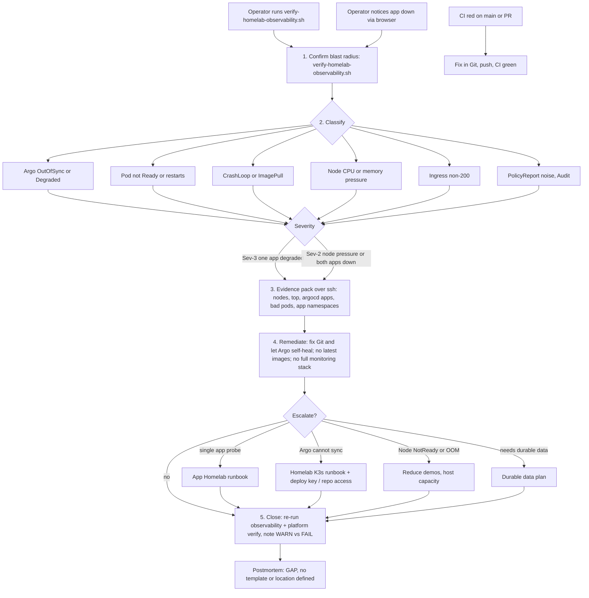

# 21 — Incident response

ไม่มีช่องทาง alert อัตโนมัติ ("There is **no on-call pager** for Homelab") การตรวจพบมาจาก operator รัน verify script หรือเห็น CI แดง กระบวนการด้านล่างมาจาก `HOMELAB-OBSERVABILITY-RUNBOOK.md` §5 (reused, snapshot copy)

Sources: `operations/platform/HOMELAB-OBSERVABILITY-RUNBOOK.md` §5.1–5.3, `infra/platform/observability/alerts/README.md`, `operations/platform/PRODUCTION-GAPS.md` ("Alert ownership / on-call: Design-only rules; not applied")

## Gaps

- ไม่มี alert channel (Sev-1 "Not defined for Homelab")
- ไม่มี postmortem template หรือที่เก็บ incident log ใน repo
- DEMO_ONLY data loss (Chroma emptyDir) ถือเป็น expected ไม่ใช่ incident

## Open questions

- ต้องการต่อ Homelab เข้ากับ Telegram alert ที่ใช้กับ service อื่นหรือไม่
- เก็บบันทึก incident ไว้ที่ใด (knowledge store / repo นี้ / architecture-docs)
