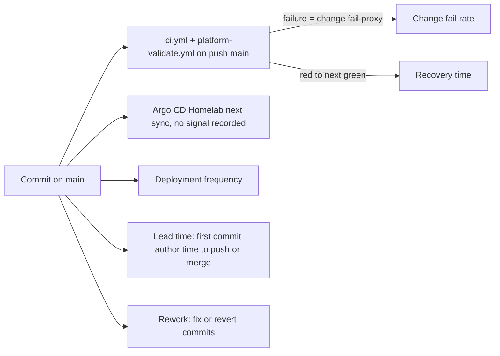

# 22 — DORA metrics

ช่วงวัด: 90 วัน **2026-08-06 → 2026-11-04** (วัด 2026-11-04 หลัง `git fetch`) ที่ `origin/main` `f80262a`

**นิยาม deployment ของ repo นี้:** ไม่มี deploy job; commit ที่เข้า `main` (first-parent) คือ deployment เพราะ Argo CD Homelab อ่าน `targetRevision: main` (ADR-0002) ไม่มีสัญญาณว่า Argo sync สำเร็จ จึงใช้ผล CI บน push `main` เป็น proxy ของ "deployment failure"

ข้อควรระวัง: commit ก่อน `e06bf74` (2026-10-11) เป็นประวัติจาก `git subtree split` ของ solo-empire ตอนนั้น Argo ยังชี้ solo-empire จึงแยกตัวเลข "90 วันทั้งหมด" กับ "ช่วง standalone" (2026-10-11 → 2026-11-04)

| Metric | How measured here | Value | Command |
|---|---|---|---|
| Deployment frequency | first-parent commits on `origin/main` | 90 d: **47 commits on 22 distinct days** (≈ 3.7 / week). Standalone: **13 commits on 5 days** (2026-10-11 → 10-23); none since 2026-10-23 | `git log --first-parent --since=2026-08-06 --format='%ad' --date=short origin/main \| sort \| uniq -c`; same with `e06bf74^..origin/main` |
| Lead time for changes | direct push: commit author time → first workflow run on `main` for that SHA; PR: first PR commit author time → merge | direct pushes (9 SHAs with runs, standalone): **≤ 0.2 min** (push right after commit); PR #2: **20.8 min** (`cbdcdef` 09:23:22Z → merged 09:44:12Z, 2026-10-17) | `gh run list --limit 100 --json workflowName,event,headBranch,createdAt,headSha` + `git log -1 --format=%aI <sha>`; `gh api repos/bookchaowalit/platform-infra-kit/pulls/2/commits`; `gh pr list --state all --json mergedAt` |
| Change fail rate | distinct push-`main` SHAs where any workflow ended `failure` | **8 / 10 = 80 %** (Platform Validate red on `e06bf74`, `5ff8962`, `155df13`, `788e8dd`, `42f5053`, `ed91c4f`, `856a6ec`; CI red on `25a0838`). Per workflow: Platform Validate 7 / 8, CI 1 / 3 | `gh run list -R bookchaowalit/platform-infra-kit --limit 100 --json workflowName,event,headBranch,conclusion,headSha` |
| Failed deployment recovery time | red run on `main` → next green run of the same workflow | CI: **16.7 min** (`25a0838` 15:06:57Z → `f80262a` 15:23:38Z, 2026-10-23). Platform Validate: **≈ 6 d 1.6 h** (`e06bf74` 2026-10-11 08:08:35Z → `7e1b450` 2026-10-17 09:44:14Z) | same `gh run list` output ordered by `createdAt` |
| Deployment rework rate | first-parent commits whose subject starts with `fix` or `Revert` | 90 d: **2 / 47 = 4.3 %** (`ba3defe` fix, `42f5053` Revert). Standalone: **1 / 13 = 7.7 %**; 2 / 13 = 15.4 % if `f80262a` (CI fix, subject "Make … executable") is counted | `git log --first-parent --since=2026-08-06 --format='%h %s' origin/main \| grep -Ei '^[0-9a-f]+ (fix\|revert)'` |

Sources: `git log origin/main`, `gh run list -R bookchaowalit/platform-infra-kit` (27 runs total: CI 5, Platform Validate 10, Shared infrastructure acceptance 12 on the PR #1 branch), `gh pr list --state all`, `.github/workflows/*.yml`

## Caveats

- Platform Validate แดงต่อเนื่อง 2026-10-11 → 10-13 เป็นปัญหาที่ติดมาตอนแยก repo (บน `856a6ec` เหลือแค่ `Trivy Config Scan`) แก้ใน PR #2 ด้วย `.trivyignore.yaml` ไม่ใช่ความผิดพลาดของแต่ละ commit; CFR 80 % จึงสูงเกินจริงถ้าตีความเป็น "change ทำให้ production พัง"
- ไม่มีข้อมูลว่า Homelab sync/ล้มเมื่อไร ค่าที่ production วัดไม่ได้
- CI run history มีเฉพาะตั้งแต่ 2026-10-11 (ก่อนนั้น workflow อยู่ใน solo-empire) lead time/CFR/recovery ก่อนหน้านั้นวัดไม่ได้ใน repo นี้
- commits `3da4e76`, `8be9b76`, `57e4b75` ไม่มี run ของตัวเอง (ถูก push รวมกับ commit ถัดไป)

## Open questions

- จะนับ deployment เป็น "commit บน main" หรือ "Argo sync ที่เปลี่ยน revision บน Homelab" — แบบหลังต้องมี export จาก Argo CD
